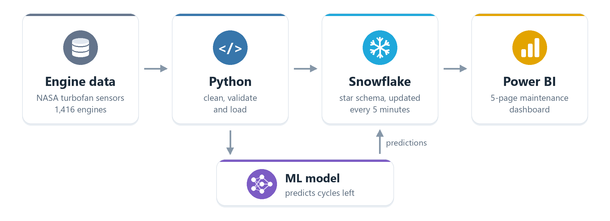

# Aircraft Engine Maintenance Analytics

[](https://github.com/SabaTamizi-eng/aircraft-engine-maintenance-analytics/actions/workflows/tests.yml)

Predictive maintenance analytics on NASA's turbofan engine simulation data (C-MAPSS).
Sensor data is loaded into Snowflake, modelled as a star schema, kept up to date with
streams and tasks, and reported in Power BI. A LightGBM model per fleet estimates how
many cycles each engine has left before it fails (remaining useful life, RUL).

The question behind it is the one a maintenance planner deals with every week: which
engines are closest to failure, and how much can we trust the estimate?


## How it works



1. `pipeline/transform.py` parses the NASA files and checks them (engine counts, missing
   values, duplicate or missing cycles).
2. `pipeline/load_snowflake.py` stages the CSV files and loads them into the RAW schema
   with `COPY INTO`.
3. A stream on the raw table picks up new rows. A task runs every 5 minutes and calls a
   stored procedure that merges them into the star schema (`sql/04_cdc_streams_tasks.sql`).
4. `pipeline/simulate_feed.py` sends new cycles for in-service engines in small batches, so
   the incremental load can be tested end to end.
5. `ml/train_rul_model.py` trains one LightGBM model per fleet on the run-to-failure
   engines and predicts the remaining life of every in-service engine; the predictions are
   loaded into Snowflake next to the sensor data.
6. Power BI reads the views in the ANALYTICS schema through a read-only service user, or
   the local CSV extract when there's no Snowflake account. See [powerbi/](powerbi/).

The data model is described in [docs/data_model.md](docs/data_model.md).

## Results

- 1,416 engines (709 run to failure, 707 still in service) and 265,256 engine cycles
  across four fleets.
- RUL model scored on all 707 test engines ([metrics](ml/metrics.json)). For engines
  within 125 cycles of failure, the ones maintenance planning depends on: RMSE 14.5 cycles
  and 84% predicted within 20 cycles. Across all engines: RMSE 23.9, or 14.2 against
  capped truth (the convention most papers use for this dataset).
- On FD001 the first version (random forest, [metrics](ml/metrics_baseline_rf_fd001.json))
  had RMSE 20.1 and 70% within 20 cycles; the current model gets 15.0 and 82%.
- Of the 707 in-service engines, 159 (22.5%) are within 30 cycles of failure.
- Running on a Snowflake trial: 243,059 engine cycles loaded through the stream and task
  (including three simulated live batches), 8 of 8 data quality checks passing, and the
  masking and row access policies return different results per role, as intended.

## Dashboard

Five-page Power BI report ([powerbi/](powerbi/)), stored as a Power BI Project so the
model and report are plain text in Git. It reads either Snowflake or the local CSV
extract (one parameter), with the same tables and column types in both.

| | |
|---|---|
|  |  |
| **Engine detail:** one engine's sensor over its life, and which sensors changed most | **Reliability:** engine life by fleet and the sensors that change most |
|  |  |
| **Model performance:** predicted vs. actual RUL, error by health status | **Data quality:** check results and data loaded per fleet |

## Notes

- **FD004 engine counts.** The dataset readme says 248 training and 249 test engines,
  but the files contain 249 and 248. The validation in `transform.py` flagged it.
- **RUL is capped at 125 cycles for training.** Engines barely change early in life, so
  the model isn't asked to tell 200 cycles left from 300. That's also why the error is
  much higher for young engines (22% of FD002 and 27% of FD004 test engines have more
  than 125 cycles left) than for engines close to failure.
- **Operating conditions.** FD002 and FD004 run in six flight conditions, which shift the
  sensor readings far more than wear does. Each sensor is normalised within its
  condition (found with k-means on the three operational settings) before features are
  built. Without this step those two fleets can't be modelled.
- **Features.** Per sensor: rolling means over 5, 15 and 30 cycles, a 15-cycle rolling
  standard deviation, an exponentially weighted mean and the slope over the last 20
  cycles. Sensors that don't vary after normalisation are dropped.
- **Model selection.** Settings are chosen by 5-fold cross-validation grouped by engine
  (an engine is never in both the training and validation fold). The test engines are
  only used for the final scores.
- **One transaction around the stream.** The procedure reads the stream twice (new
  engines, then cycles). Wrapping both in a transaction means they see the same rows,
  and the stream offset only moves when it commits.
- **Policies check `CURRENT_ROLE()`.** `IS_ROLE_IN_SESSION()` also counts secondary
  roles, so a user who has all three project roles would always see unmasked data.
- **Serial numbers are synthetic.** The dataset doesn't have any; they exist to test the
  masking policy.
- **Key-pair authentication for scripts.** The Python scripts sign in with an RSA key
  pair, because password sign-in needs an MFA code on every run. If the account was
  created through Google or Microsoft sign-in, the connector needs the user's
  `LOGIN_NAME` (often the email address), not the user name.

## Running it

Python 3.10+ for the local part. For Snowflake, a trial account is enough, but choose
the Enterprise edition, because masking and row access policies need it.

```bash
pip install -r requirements.txt

python -m pipeline.download_data
python -m pipeline.transform
python -m ml.train_rul_model                # a few minutes (cross-validation per fleet)
python -m pipeline.export_powerbi_extract   # local CSVs for Power BI

python -m pytest                            # unit tests (also run by GitHub Actions)
```

For Snowflake, register an RSA public key for your user
([key-pair authentication](https://docs.snowflake.com/en/user-guide/key-pair-auth)),
copy `.env.example` to `.env` and fill it in, then:

```bash
python -m pipeline.run_sql                                  # sql/00 to sql/06, in order
python -m pipeline.load_snowflake --initial --predictions
python -m pipeline.simulate_feed --batches 3 --cycles-per-batch 10
```

`sql/07_analysis_queries.sql` has example analysis queries. To connect Power BI, run
`sql/08_powerbi_reader.sql` and create a token for `POWERBI_READER` (steps in
[powerbi/README.md](powerbi/README.md)). `sql/99_teardown.sql` drops everything again.

## Layout

```text
pipeline/  download, transform, Snowflake loading, feed simulator, Power BI extract
ml/        RUL model and metrics
tests/     unit tests
sql/       Snowflake scripts: 00-06 setup, 07 analysis, 08 Power BI user, 99 teardown
powerbi/   Power BI project (.pbip), theme, readable copies of the DAX and Power Query
docs/      data model, sensor list, report screenshots
data/      dataset source (data files are not committed)
```

## Data

NASA Prognostics Center of Excellence, Turbofan Engine Degradation Simulation Data Set.
A. Saxena, K. Goebel, D. Simon and N. Eklund, "Damage Propagation Modeling for Aircraft
Engine Run-to-Failure Simulation," PHM08, 2008. More in [data/README.md](data/README.md).

---
Saba Tamizi · [GitHub](https://github.com/SabaTamizi-eng)
