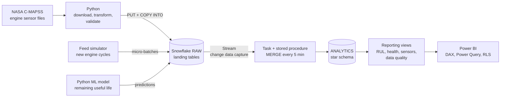

# Aircraft Engine Maintenance Analytics

**An end-to-end data analytics project: NASA jet engine sensor data → Snowflake (ELT, change
data capture, governance) → Power BI, with a machine learning model that predicts how many
cycles each engine has left before failure.**


## Why this matters

Unplanned engine removals are among the most expensive events in aviation maintenance.
If a maintenance team knows which engines are closest to failure, it can plan shop visits,
order parts early, and avoid aircraft-on-ground delays. This project builds the data platform
and reporting behind that decision, using NASA's run-to-failure simulation of turbofan engines.

## Results so far

| | |
|---|---|
| Engines modelled | **1,416** across 4 fleets (709 run to failure, 707 in service) |
| Engine cycles validated | **265,256** rows, 21 sensors each, **6 of 6** data quality checks passing |
| Remaining-life prediction (fleet FD001) | **RMSE 20.1 cycles**, MAE 14.6 cycles, **70%** of engines within 20 cycles |
| Data issue found | NASA's readme swaps the FD004 engine counts (249/248); the validation step caught it |

Model metrics are generated by `ml/train_rul_model.py` and saved in
[`ml/metrics_fd001.json`](ml/metrics_fd001.json).

## Architecture



## What it demonstrates

| Area | Where |
|---|---|
| **ELT pipeline**: Python loads files to an internal stage with `PUT` and `COPY INTO` | [`pipeline/`](pipeline/) |
| **Data modelling**: raw → staging → star schema (fleet, engine and sensor dimensions, cycle fact) | [`sql/01`–`03`](sql/), [`docs/data_model.md`](docs/data_model.md) |
| **Change data capture**: Snowflake stream + scheduled task + stored procedure (`MERGE`, transactions) | [`sql/04_cdc_streams_tasks.sql`](sql/04_cdc_streams_tasks.sql) |
| **Incremental loads**: a simulator delivers new engine cycles in batches to show CDC working | [`pipeline/simulate_feed.py`](pipeline/simulate_feed.py) |
| **Governance and security**: roles, column masking, row-level security by fleet | [`sql/00_setup.sql`](sql/00_setup.sql), [`sql/05_governance.sql`](sql/05_governance.sql) |
| **Data quality**: validation in Python and an automated checks view in Snowflake | [`pipeline/transform.py`](pipeline/transform.py), [`sql/06_data_quality.sql`](sql/06_data_quality.sql) |
| **Advanced SQL**: window functions, `QUALIFY`, `UNPIVOT`, regression and percentiles, SQL UDF | [`sql/07_analysis_queries.sql`](sql/07_analysis_queries.sql) |
| **Power BI**: one Power Query function for CSV or Snowflake, DAX measures, theme, RLS | [`powerbi/`](powerbi/) |
| **Machine learning**: random forest predicting remaining useful life, PHM08 scoring | [`ml/train_rul_model.py`](ml/train_rul_model.py) |

## Project status

- [x] Download, transform and validate the NASA data (Python)
- [x] Snowflake setup, raw/staging/star schema, CDC with streams and tasks, governance, data quality (SQL)
- [x] Baseline remaining-useful-life model with saved metrics
- [x] Local data extract and Power Query/DAX/theme files for the Power BI report
- [ ] Run the full pipeline in a Snowflake trial account
- [ ] Build the Power BI report (`.pbip`) and add screenshots
- [ ] Record a short demo video

## Run it

**Requirements:** Python 3.10+, and for the Snowflake part a Snowflake account
(the free trial works; choose **Enterprise** edition for masking and row access policies).

```bash
pip install -r requirements.txt

# 1. Local pipeline (no Snowflake needed)
python -m pipeline.download_data          # NASA dataset into data/raw/
python -m pipeline.transform              # validated CSVs into data/processed/
python -m ml.train_rul_model              # predictions + ml/metrics_fd001.json
python -m pipeline.export_powerbi_extract # CSVs for Power BI into data/powerbi/
```

```text
# 2. Snowflake: run these in a worksheet, in order
sql/00_setup.sql  →  01_raw.sql  →  02_staging.sql  →  03_analytics_star_schema.sql
→  04_cdc_streams_tasks.sql  →  05_governance.sql  →  06_data_quality.sql
```

```bash
# 3. Load data and watch CDC work (copy .env.example to .env and fill it in first)
python -m pipeline.load_snowflake --initial --predictions
python -m pipeline.simulate_feed --batches 3 --cycles-per-batch 10 --interval 60
```

Then open [`powerbi/README.md`](powerbi/README.md) to build the report. When you are done,
`sql/99_teardown.sql` removes everything the project created.

## Repository layout

```text
pipeline/   Python: download, transform + validation, Snowflake loading, feed simulator, Power BI extract
ml/         Remaining-useful-life model and saved metrics
sql/        Snowflake scripts, numbered in run order
powerbi/    Power Query (M), DAX measures, theme, build guide
docs/       Data model and sensor dictionary
data/       Dataset source and citation (data files are not committed)
```

## Data

NASA Prognostics Center of Excellence, *Turbofan Engine Degradation Simulation Data Set*
(C-MAPSS). Saxena, Goebel, Simon and Eklund, "Damage Propagation Modeling for Aircraft Engine
Run-to-Failure Simulation," PHM08, 2008. Details in [`data/README.md`](data/README.md).
Engine serial numbers in the model are synthetic, created to demonstrate column masking.

## Author

**Saba Tamizi**: data analytics developer (Power BI, SQL, ETL, Python).
GitHub: [@SabaTamizi-eng](https://github.com/SabaTamizi-eng)
