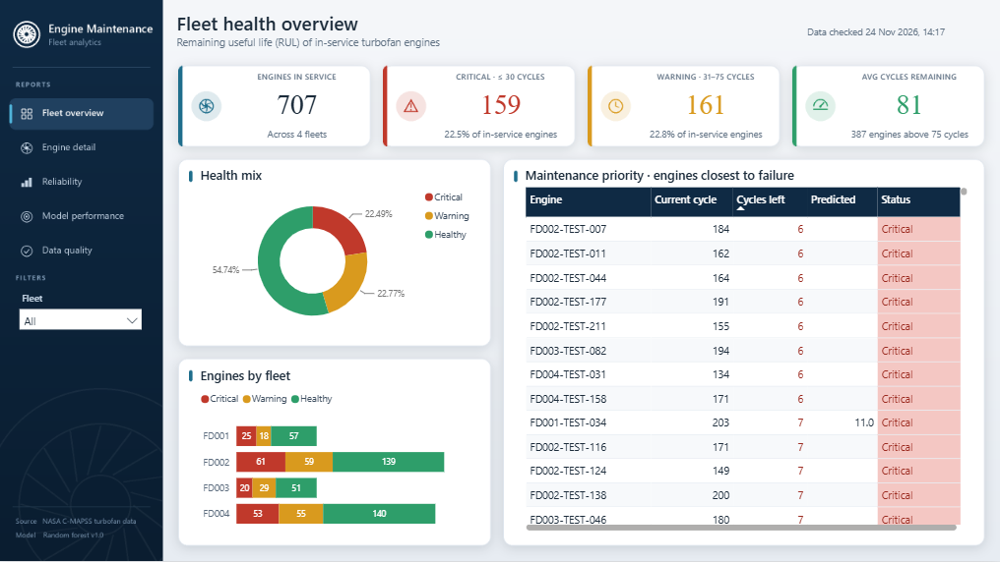
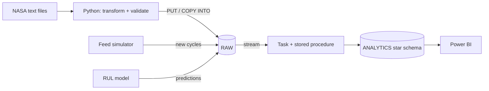
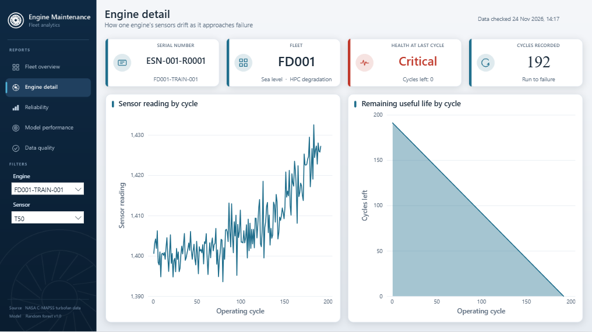
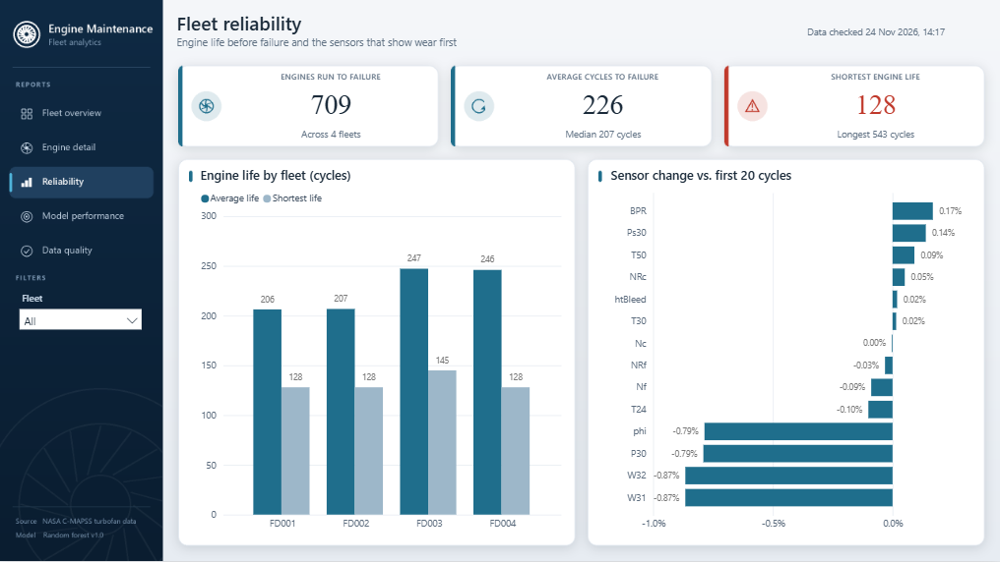
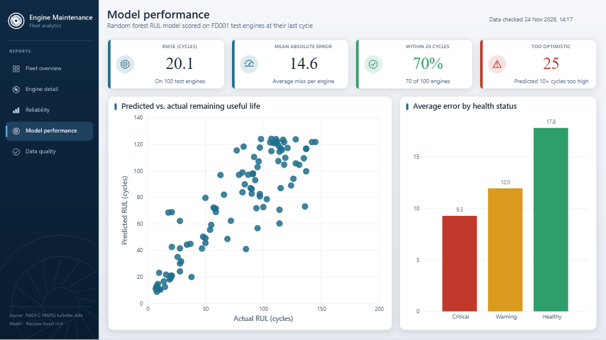
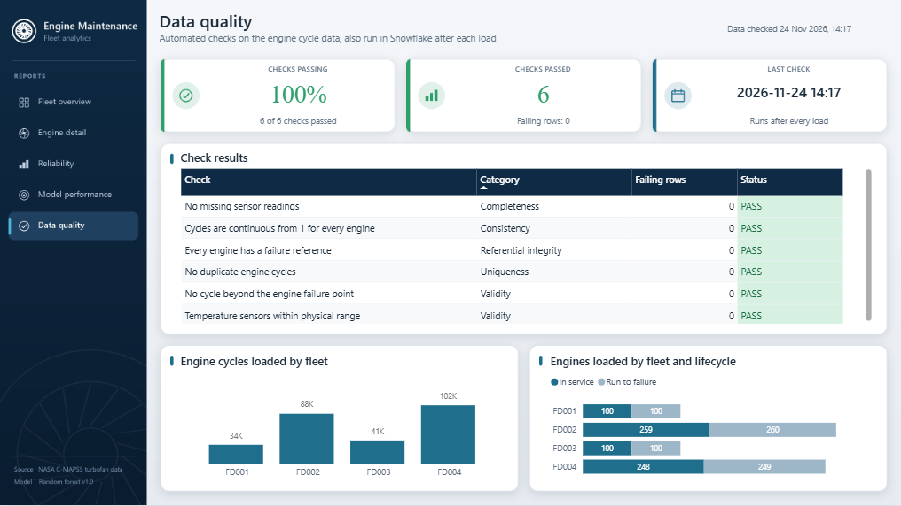

# Aircraft Engine Maintenance Analytics

[](https://github.com/SabaTamizi-eng/aircraft-engine-maintenance-analytics/actions/workflows/tests.yml)

Predictive maintenance analytics on NASA's turbofan engine simulation data (C-MAPSS).
Sensor data is loaded into Snowflake, modelled as a star schema, kept up to date with
streams and tasks, and reported in Power BI. A random forest model estimates how many
cycles each engine has left before it fails (remaining useful life, RUL).

The question behind it is the one a maintenance planner deals with every week: which
engines are closest to failure, and how much can we trust the estimate?



## How it works



1. `pipeline/transform.py` parses the NASA files and checks them (engine counts, missing
   values, duplicate or missing cycles).
2. `pipeline/load_snowflake.py` stages the CSV files and loads them into the RAW schema
   with `COPY INTO`.
3. A stream on the raw table picks up new rows. A task runs every 5 minutes and calls a
   stored procedure that merges them into the star schema (`sql/04_cdc_streams_tasks.sql`).
4. `pipeline/simulate_feed.py` sends new cycles for in-service engines in small batches, so
   the incremental load can be tested end to end.
5. Power BI reads the views in the ANALYTICS schema. See [powerbi/](powerbi/).

The data model is described in [docs/data_model.md](docs/data_model.md).

## Results so far

- 1,416 engines (709 run to failure, 707 still in service) and 265,256 engine cycles
  across four fleets.
- Baseline RUL model on fleet FD001: RMSE 20.1 cycles, MAE 14.6 cycles, and 70% of
  engines within 20 cycles of the true RUL ([metrics](ml/metrics_fd001.json)).
- Of the 707 in-service engines, 159 (22.5%) are within 30 cycles of failure.

## Dashboard

Five-page Power BI report ([powerbi/](powerbi/)), stored as a Power BI Project so the
model and report are plain text in Git.

| | |
|---|---|
|  |  |
| **Engine detail:** sensor drift and remaining life for one engine | **Reliability:** engine life by fleet and the sensors that change most |
|  |  |
| **Model performance:** predicted vs. actual RUL | **Data quality:** check results and data loaded |

## Notes

- **FD004 engine counts.** The dataset readme says 248 training and 249 test engines,
  but the files contain 249 and 248. The validation in `transform.py` flagged it.
- **RUL is capped at 125 cycles for training.** Engines barely change early in life, so
  the model isn't asked to tell 200 cycles left from 300. This is the usual approach
  for this dataset.
- **Constant sensors.** Seven of the 21 sensors don't change in FD001, so the model uses
  the other 14 plus 10-cycle rolling means.
- **One transaction around the stream.** The procedure reads the stream twice (new
  engines, then cycles). Wrapping both in a transaction means they see the same rows,
  and the stream offset only moves when it commits.
- **Policies check `CURRENT_ROLE()`.** `IS_ROLE_IN_SESSION()` also counts secondary
  roles, so a user who has all three project roles would always see unmasked data.
- **Serial numbers are synthetic.** The dataset doesn't have any; they exist to test the
  masking policy.

## Running it

Python 3.10+ for the local part. For Snowflake, a trial account is enough, but choose
the Enterprise edition, because masking and row access policies need it.

```bash
pip install -r requirements.txt

python -m pipeline.download_data
python -m pipeline.transform
python -m ml.train_rul_model
python -m pipeline.export_powerbi_extract   # local CSVs for Power BI

python -m pytest                            # unit tests (also run by GitHub Actions)
```

In Snowflake, run the files in `sql/` in order (`00` to `06`). Then copy `.env.example`
to `.env`, fill it in, and load the data:

```bash
python -m pipeline.load_snowflake --initial --predictions
python -m pipeline.simulate_feed --batches 3 --cycles-per-batch 10
```

`sql/99_teardown.sql` drops everything again.

## To do

- Run the full pipeline on a Snowflake trial account and switch the report to Snowflake
- Try a model for the six-condition fleets (FD002, FD004)
- Record a short demo of the report

## Layout

```text
pipeline/  download, transform, Snowflake loading, feed simulator, Power BI extract
ml/        RUL model and metrics
tests/     unit tests
sql/       Snowflake scripts, in run order
powerbi/   Power BI project (.pbip): TMDL model, PBIR report, theme
docs/      data model, sensor list, report screenshots
data/      dataset source (data files are not committed)
```

## Data

NASA Prognostics Center of Excellence, Turbofan Engine Degradation Simulation Data Set.
A. Saxena, K. Goebel, D. Simon and N. Eklund, "Damage Propagation Modeling for Aircraft
Engine Run-to-Failure Simulation," PHM08, 2008. More in [data/README.md](data/README.md).

---
Saba Tamizi · [GitHub](https://github.com/SabaTamizi-eng)
