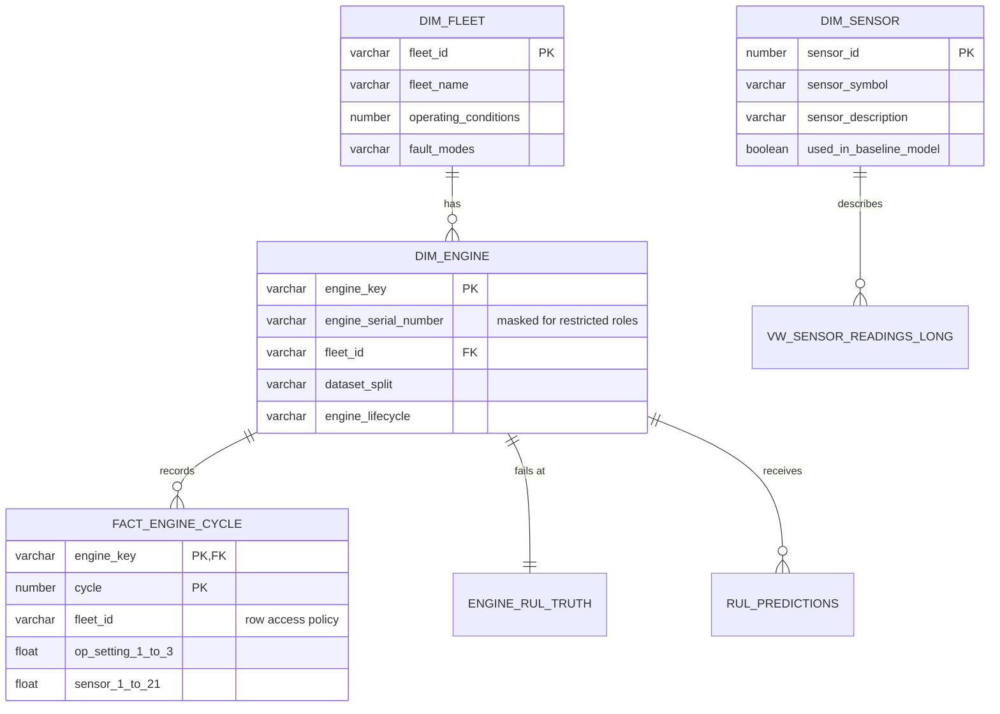

# Data model

## Snowflake layers

| Schema | Objects | Purpose |
|---|---|---|
| `RAW` | `ENGINE_CYCLES_RAW`, `ENGINE_RUL_TRUTH`, `RUL_PREDICTIONS_RAW`, `ENGINE_CYCLES_STREAM` | Files land here unchanged; the stream captures new rows |
| `STAGING` | `FN_ENGINE_KEY`, `STG_ENGINE_CYCLES`, `STG_ENGINE_RUL_TRUTH`, `STG_RUL_PREDICTIONS` | Business key, de-duplication, derived failure cycle |
| `ANALYTICS` | `DIM_FLEET`, `DIM_ENGINE`, `DIM_SENSOR`, `FACT_ENGINE_CYCLE`, reporting views | Star schema for Power BI |

## Star schema

## Reporting views

| View | Grain | Key columns |
|---|---|---|
| `VW_ENGINE_CYCLE_RUL` | engine x cycle | sensors, `actual_rul`, `health_status` |
| `VW_ENGINE_CURRENT_HEALTH` | engine (latest cycle) | `actual_rul`, `predicted_rul`, `prediction_error` |
| `VW_SENSOR_READINGS_LONG` | engine x cycle x sensor | `sensor_id`, `reading` |
| `VW_DATA_QUALITY_CHECKS` | check | `failing_rows`, `status` |

`actual_rul` = failure cycle - current cycle. For train engines the failure cycle is the
last cycle; for test engines it's the last observed cycle + NASA's true RUL.

`health_status`: Critical if RUL <= 30, Warning if <= 75, otherwise Healthy.

## Sensors

| ID | Symbol | Description | Unit | Used in model |
|---|---|---|---|---|
| 1 | T2 | Total temperature at fan inlet | deg R | |
| 2 | T24 | Total temperature at LPC outlet | deg R | yes |
| 3 | T30 | Total temperature at HPC outlet | deg R | yes |
| 4 | T50 | Total temperature at LPT outlet | deg R | yes |
| 5 | P2 | Pressure at fan inlet | psia | |
| 6 | P15 | Total pressure in bypass duct | psia | |
| 7 | P30 | Total pressure at HPC outlet | psia | yes |
| 8 | Nf | Physical fan speed | rpm | yes |
| 9 | Nc | Physical core speed | rpm | yes |
| 10 | epr | Engine pressure ratio (P50/P2) | ratio | |
| 11 | Ps30 | Static pressure at HPC outlet | psia | yes |
| 12 | phi | Ratio of fuel flow to Ps30 | pps/psi | yes |
| 13 | NRf | Corrected fan speed | rpm | yes |
| 14 | NRc | Corrected core speed | rpm | yes |
| 15 | BPR | Bypass ratio | ratio | yes |
| 16 | farB | Burner fuel-air ratio | ratio | |
| 17 | htBleed | Bleed enthalpy | index | yes |
| 18 | Nf_dmd | Demanded fan speed | rpm | |
| 19 | PCNfR_dmd | Demanded corrected fan speed | rpm | |
| 20 | W31 | HPT coolant bleed | lbm/s | yes |
| 21 | W32 | LPT coolant bleed | lbm/s | yes |

Sensor names follow Saxena et al. (2008). LPC/HPC = low/high pressure compressor,
LPT/HPT = low/high pressure turbine.
