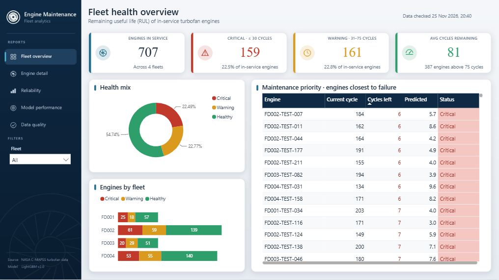

# Power BI

`EngineMaintenance.pbip` is a Power BI Project: the semantic model is stored as TMDL
(`EngineMaintenance.SemanticModel/`) and the report as PBIR (`EngineMaintenance.Report/`),
so both can be reviewed in Git.

## Opening it

1. Run the local pipeline from the repository root (`python -m pipeline.download_data`,
   `python -m pipeline.transform`, `python -m ml.train_rul_model`,
   `python -m pipeline.export_powerbi_extract`).
2. Open `EngineMaintenance.pbip` in Power BI Desktop.
3. Transform data > Edit parameters, set `DataFolder` to your `data\powerbi\` folder
   (with the trailing backslash), then Refresh.

To read from Snowflake instead, set `SourceMode` to `Snowflake` and `SnowflakeServer` to
your account URL. Table and column names are the same in both sources.

## Model

| Table | Source | Notes |
|---|---|---|
| Fleet, Engine, Sensor | `DIM_*` | dimensions |
| Engine Cycles | `VW_ENGINE_CYCLE_RUL` | one row per engine and cycle |
| Engine Health | `VW_ENGINE_CURRENT_HEALTH` | latest cycle per engine, with predictions |
| Sensor Readings | `VW_SENSOR_READINGS_LONG` | unpivoted in Power Query when reading CSV |
| Data Quality | `VW_DATA_QUALITY_CHECKS` | |
| _Measures | | all DAX measures, grouped in display folders |

All tables load through one Power Query function, `fnLoadTable`, which switches between
CSV and Snowflake. `FLEET_ID` on the fact tables is hidden; it's there for the Snowflake row
access policy.

## Pages

| Page | What it answers |
|---|---|
| Fleet overview | How many in-service engines are critical, and which ones need maintenance first |
| Engine detail | How one engine's sensors drift as it wears out |
| Reliability | How long engines last per fleet, and which sensors change most |
| Model performance | How accurate the RUL predictions are |
| Data quality | Whether the data passed its checks and what was loaded |

## Design

- Page backgrounds (sidebar, tiles, KPI accents and icons) are images in
  `EngineMaintenance.Report/StaticResources/RegisteredResources/`; the visuals sit on top
  with transparent backgrounds.
- `theme.json` sets fonts, title styles and axis colours for every visual.
- The sidebar items are page navigation buttons (Ctrl + click in Desktop).
- Table status colours come from the `Health Status Color` / `Health Status Font Color`
  measures (conditional formatting by field value).
